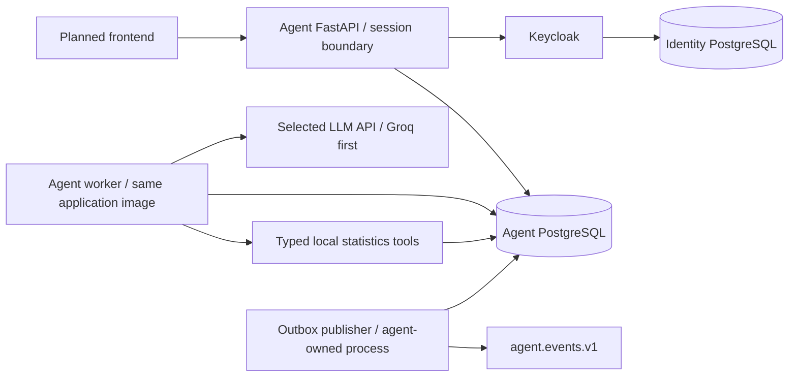
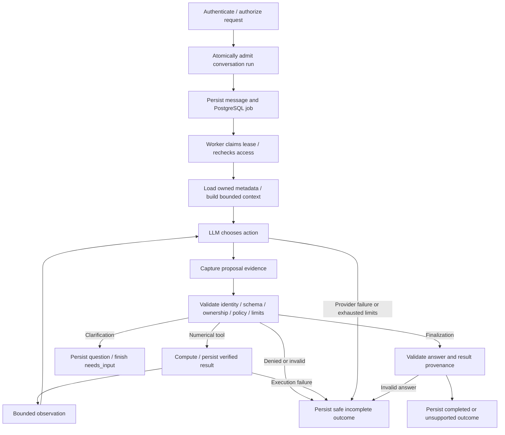

# Statistics agent architecture

Updated: 29 October 2026. **Design confirmed by the user; implementation is partial.**
This is the shared architecture for plans 5–8. It does not add runtime behavior,
freeze an HTTP API, or replace the canonical parent-workspace implementation order.

## Current implementation and planned work

| Area | Available now | Still planned |
|---|---|---|
| Access | Keycloak/OIDC, backend token storage/refresh, cookie sessions, local JWT validation, CSRF, owner-filter helper | Apply ownership to every business resource |
| Agent | One CrewAI Agent per single-use controlled execution, Groq adapter, limits/retries, validated finalize_statistics | Persistent conversation context and clarification channel |
| Data/tools | Dataset lifecycle and all four owned numerical bindings/executor with typed artifacts | Full model/tool composition and production policy |
| Execution | Internal in-process runner and event-sink interface | PostgreSQL jobs, leases, persistent results, transactional outbox and Kafka publisher |
| Product | Health/auth/session APIs | Dataset/conversation/run/result APIs and frontend |

Plan 4.6 delivery is accepted from the user's pull confirmation. Its scoped Groq
live check is recorded in [provider verification](provider-verification.md).
Azure remains unconfigured/unverified. Current answer statuses are completed,
unsupported and incomplete; needs_input is a planned compatible contract change.

## Confirmed product decisions

- A conversation can attach several owned, immutable datasets. The first version
  analyzes them separately and presents results side by side. No joins, combined
  samples or cross-dataset correlations. Every numerical tool call names exactly
  one dataset; the model cannot calculate new numbers from summaries.
- Store user-visible history in PostgreSQL. Send bounded recent context and
  verified result summaries to the model, rather than the complete history/CSV.
- Permit only one queued or running execution per conversation. Reject another
  new submission as busy; do not silently queue, replace or cancel it. An
  idempotent replay of the same accepted request returns the existing run.
- Missing/ambiguous inputs cause clarification. End the current run as needs_input
  and release the worker. The reply starts a new run in the same conversation.
- If final explanation fails after computation, expose authorized, verified
  persisted results with an explicit incomplete outcome. Never invent prose or
  label the analysis completed solely because one calculation succeeded.
- Four numerical tools initially; no charts, data cleaning, generated code or
  mandatory MCP integration. PostgreSQL dispatches work; Kafka carries telemetry.

## Service topology

API, worker and publisher are roles of the agent application, not independently
owned microservices with their own databases. They can share one image; the
publisher can run as a bounded worker loop initially. Keycloak remains a separate
service/database. Keep the selected React/Vercel and Azure Container Apps hosting
direction; infrastructure, database persistence and scaling belong to plan 10.
Keycloak is used for login, refresh and required key retrieval, not introspection
on every tool/query. Never copy OAuth/provider secrets into jobs or Kafka.

## Nodes and execution edges

These nodes are controlled Python modules/functions, not another graph framework
or one microservice each. CrewAI remains the chosen agent framework; retain the
controlled runner instead of enabling its native unrestricted tool executor.

The worker must persist numerical results before requesting the final explanation.
Every terminal path releases conversation admission and records its final state
and outbox evidence transactionally where possible. The diagram omits error edges
from database/evidence/access operations for readability: these fail closed and
must not dispatch further tools. A later failure cannot undo earlier execution.

## Identity, state and persistence

| Identity | Meaning |
|---|---|
| conversation_id | Owner-scoped persistent history and attached dataset references |
| run_id | One accepted question/reply execution; a clarification reply receives a new run ID |
| session_id | One immutable execution-attempt context used for telemetry; not the OAuth/browser session |
| auth_session_ref | Server-side reference to the authorized browser session; restricted internal data |
| model_call_id / attempt_index | One logical model call and its bounded provider retries |
| tool_call_id | One captured proposal, correlated with outcome and computed-result provenance |

Proposed run lifecycle: queued, running, finished. Finished outcome: completed,
needs_input, unsupported or incomplete, with a separate fixed reason code.
These are design values, not implemented HTTP enums. Persisted results can exist
for an incomplete run. Do not overload needs_input as a failed job or leave its
lease active. Optional cancellation requires a separately specified contract;
no cancellation enum or undo guarantee is introduced here.

Reuse the agent database, with separate logical tables for datasets/raw bytes,
artifacts, conversations/dataset attachments/messages, runs/results, jobs and
outbox. Conversation/run persistence belongs to plan 7; dataset/artifact storage
belongs to plan 5. Each resource carries or derives an owner issuer/subject, and
every query enforces that owner. Admin membership does not grant cross-user data.
No shared Keycloak tables, vectors or Redis are needed for this design.

Admission must be atomic at database level, such as a unique active-run constraint
per conversation, not an in-memory busy flag. Use short claim transactions and
bounded leases/heartbeats for jobs; never hold a database transaction during an
LLM call or while waiting for the user. A worker may use SKIP LOCKED to claim
available jobs. Different conversations still obey global worker/provider limits.

After a worker crash, an expired lease is evidence of interruption, not proof no
call executed. Reconcile persisted attempts/results; mark unknown outcomes and
finish incomplete unless replay is demonstrably safe. Do not blindly repeat
provider requests or tool effects. A replacement execution attempt gets its own
session_id; do not fabricate a continuous old process history.

## Conversation context

Build context at execution time from the admitted conversation revision and
dataset selection. Reject concurrent attachment changes that invalidate an active
run's snapshot. Support multiple datasets within explicit bounds; the current
runner's maximum of 16 datasets is an initial ceiling, not permission to exceed
the model-input budget. Ask the user to narrow selection when necessary.

Always include current instructions, current question and required control/tool
schemas. Add only relevant authorized metadata, recent turns and verified result
summaries within the existing reservation budget. Measure the entire payload,
including schemas, before dispatch. Drop optional old context deterministically;
never silently drop the current question, required schema, or claim an omitted
prior result was considered. Ask for clarification or stop on unavoidable limits.
Do not silently raise the existing 4096-unit per-request cap. Plan 7 must test
the full tool registry/context, including multi-dataset follow-ups, against it.

Stored history and model context are different views. Paginate history for the
UI; do not replay it all. Resolve prior result IDs through server-owned mappings
and current ownership checks. The single-run finalizer currently accepts only
results from that run: plan 7 must define and test an authorized prior-result
provenance mapping before permitting citations across runs. Never trust an ID
copied from a previous model message or client request as evidence by itself.

Dataset deletion/revoked access makes affected references unavailable; context
construction must not resurrect hidden data from cached messages or summaries.
Plan 7 must define retention/redaction behavior for historical text and artifacts
and test it before exposing deletion/history together. Arbitrary user text can
contain sensitive information; excluding auth fields is not a PII-scanning claim.

## Tools and control functions

| Name | Kind | Responsibility |
|---|---|---|
| inspect_dataset | Numerical/data tool | Dimensions, columns, types and missing counts for one owned dataset |
| describe_columns | Numerical tool | Approved descriptive statistics for selected numeric columns |
| aggregate_statistics | Numerical tool | Allowed count/sum/mean/min/max with bounded optional grouping |
| correlate_columns | Numerical tool | Pearson/Spearman over two columns of the same dataset |
| request_clarification | Control function, planned | Bounded question/options for missing dataset, column or analysis intent; finish needs_input |
| finalize_statistics | Control function, existing | Validate explanation structure and authoritative result references |

Typed tools load authorized data and compute with pandas/NumPy/SciPy, using the
semantics in [dataset/tools](dataset-tools.md). Dataset contents and tool output
are untrusted data. Control functions do not execute numerical work, create a
computed-result ID, or bypass access/limit checks. Reject a mixed batch of control
and numerical actions. Reserve both control names in the registry.

Clarification must be validated server-side, including any offered dataset/column
choices. No values or data belonging to another owner may enter the question.
Provider output alone cannot turn an access denial into a clarification fallback.
Numeric-looking claims in explanations remain nonauthoritative; the UI presents
verified typed results as the source of numerical values.

## Fallback matrix

| Condition | Required behavior |
|---|---|
| Missing dataset/ambiguous column or operation | Persist clarification, finish needs_input; reply creates new run |
| Unsupported analysis, joins or transformations | Explain scope, finish unsupported; no improvised code |
| Invalid arguments/name or denied policy/access | Safe incomplete outcome; no execution or guessed repair |
| Selected retryable rate-limit/server error | Existing bounded retry rules; same logical model call, distinct attempt index |
| Unknown provider outcome or unsafe replay | Record uncertainty, stop; no blind retry or provider switch |
| Tool error, deadline or budget exhaustion | Incomplete with fixed reason; expose only authorized persisted partial results |
| Invalid final explanation/reference | Incomplete; preserve verified results without fabricated substitute narrative |
| Database/evidence persistence unavailable | Fail closed; no tool dispatch relying on unpersisted required evidence |
| Kafka unavailable | Keep durable outbox entries and retry publication; do not lose accepted work/events |
| Conversation already active | Reject new admission as busy; same idempotency key may return original run |

If outbox storage itself cannot commit, broker retry is not a remedy. Required
pre-execution evidence must be durable before executing a tool. A post-execution
commit failure may leave an unknown outcome and needs reconciliation, not a
claim that the calculation never happened.

## Kafka topics and event evidence

Initial agent-owned topic: **agent.events.v1**, partition key session_id. It
carries the existing session.started, tool_call.requested, tool_call.completed,
tool_call.failed, model_call.completed, model_call.failed and session.ended types.
There is no Kafka run-command topic: PostgreSQL jobs dispatch this agent's work.
Broker provisioning and Kafka consumer/classifier ownership remain team integration
boundaries, not additional agent microservices.

Keep event_id stable across outbox retries. Publish at least once; consumers
deduplicate by event_id. Preserve per-session sequence order at the publisher;
Kafka partitioning alone does not fix out-of-order concurrent publishers. Include
conversation_id/run_id references for correlation without exposing browser-session
or identity secrets. A replacement session after a crash is a separate ordered
stream, linked to the same run. Do not promise exactly-once model/tool execution.

The current requested-tool events are digest-only; outcomes lack tool names.
That is insufficient for behavioral classifiers and for distinguishing control
functions from numerical tools. Plan 7 must version/test the payload contract
before adding classification evidence. Preserve the seven event type names;
do not silently reinterpret existing fields under an unchanged contract.

Required evidence design:

- Existing IDs, timestamps, per-session sequence, model attempts and pinned
  provider/prompt/toolset/policy references.
- Known canonical tool name and kind (numerical/control). For arbitrary unknown
  names publish an unknown marker plus digest/length, not unchecked raw text.
- Bounded argument shape/validation features and approved values such as method
  enum, selected-column count and missing-data strategy. Never raw cells, full
  arguments, prompts, arbitrary unknown keys or raw user-provided names.
- Ownership/policy verdict and fixed reason codes where evaluated; not_evaluated
  must remain distinct from allowed/denied. Execution failure is not an attack label.
- Original proposal digest/length and explicit malformed/oversized-evidence status.
  Capture attempted proposals before execution validation without silently dropping
  unknown/invalid attempts. Restricted evidence references require their own
  access/retention contract; hashes cannot reconstruct omitted classifier features.
- Terminal outcome including needs_input and incomplete, with result references
  only where their exposure is authorized by the agreed event contract.

The mock scenario generator supplies ground truth separately, correlated by stable
run/session/call IDs and scenario version. Keep labels/scenario answer keys out of
model inputs and classifier inference features. No real traffic is automatically
called fraud, and no unlabeled production output becomes trusted retraining data.
Classifier/label topics are not created by this agent architecture.

## Implementation placement and acceptance

| Plan | Responsibility |
|---|---|
| 5 | Dataset contracts/storage, numerical tools and bounded persisted artifacts |
| 6 | Production tool/control policies, limits and ownership enforcement at execution boundaries |
| 7 | Conversations, context, clarification/prior-result integration, jobs, APIs, outbox and Kafka evidence |
| 8 | Multi-dataset conversation UI, busy/clarification/partial-result states and bounded polling |
| 10 | Deployment, persistent storage, admission across replicas, operational acceptance and recovery |

Plan 7 intentionally extends the delivered plan 4 runner for conversation/control
integration; delivered 4.1–4.6 behavior remains historical evidence, not silently
relabelled as supporting needs_input or persistent memory. Keep compatibility and
regression proof when those contracts change. No extra top-level plan is added.

Acceptance must include cross-owner/deleted references, ambiguous dataset names,
multi-dataset separate computations, bounded follow-ups, concurrent admission,
idempotent retries, clarification releasing the lease, invalid finalization with
partial results, interruption/unknown outcomes, Kafka outage/redelivery and event
feature privacy. Mock providers run in CI; live model checks remain explicit
opt-in. No implementation, schema migration or cloud deployment occurs in this
documentation change.

Step 5.1 update — 3 November 2026: [dataset contracts](dataset-contracts.md) are
complete locally; dataset/conversation/job/tool runtime remains planned. This
contract step does not add needs_input, persistent memory or new API routes.

Step 5.2 update — 4 November 2026: [owned persistence](dataset-storage.md) is
complete locally with migration 0004_dataset_storage; required PR tests/delivery
remain pending. This adds internal dataset/artifact repositories, not CSV
parsing, conversation memory, jobs, statistics execution or business HTTP APIs.

Step 5.3 update — 4 November 2026: [pure CSV validation](csv-validation.md) is
complete locally; PR tests/delivery pending. Metadata and bounded previews come
from actual parsed data, but no storage integration, statistical execution,
conversation/job memory or HTTP endpoint is introduced.

Step 5.4 update — 4 November 2026: [internal dataset lifecycle](dataset-lifecycle.md)
is complete locally. Parsing and storage are composed with bounded offload and
ownership checks. No statistical tool, current app/lifespan wiring, run/job
state or HTTP dataset endpoint is added; required PR tests/delivery remain pending.

Step 5.5 update — 4 November 2026: [inspection/descriptive tools](descriptive-tools.md)
are complete locally, using directly pinned NumPy 2.5.4 and shared bounded CPU
admission. No policy/run API/live-model composition or event payload change;
aggregation/correlation and plan 5.7 integration remain pending.

Step 5.6 update — 5 November 2026: [aggregation/correlation](aggregation-correlation.md)
complete the four numerical bindings locally, with SciPy 1.18.1/NumPy 2.5.4.
Full runner/model/input-budget integration, production policy and run APIs remain
pending; no event payload, auth or cloud change.
